# AI Research Agent

A local, multi-agent research system that plans a topic, gathers web sources,
and produces a structured report — orchestrated as a LangGraph pipeline, powered
by a local LLM (Ollama), and persisted to PostgreSQL with a Streamlit analytics
dashboard. No cloud API keys are required.

[](config/config.py)
[](graph/workflow.py)
[](generation/llm.py)
[](app.py)
[](database/database.py)
[](LICENSE)

**Repository:** https://github.com/Reddiah16/AI-Research-Agent

---

## Table of Contents

- [Project Overview](#project-overview)
- [Key Features](#key-features)
- [System Architecture](#system-architecture)
- [Technology Stack](#technology-stack)
- [Application Screenshots](#application-screenshots)
- [Performance Monitoring and Evaluation](#performance-monitoring-and-evaluation)
- [Project Structure](#project-structure)
- [Installation and Setup](#installation-and-setup)
- [Environment Variables](#environment-variables)
- [Running the Application](#running-the-application)
- [Testing](#testing)
- [Future Improvements](#future-improvements)

---

## Project Overview

**What it does.** You enter a research topic. The system builds a research plan,
runs DuckDuckGo searches for each planned query, synthesizes the findings into a
structured Markdown report (Introduction, Key Points, Applications, Challenges,
Conclusion, References), saves the run to PostgreSQL, and exposes it for viewing,
download, and analytics.

**The problem it addresses.** Chatbots answer from model weights alone and cannot
cite current web sources or keep a durable, queryable history of what was
researched. This project turns research into a reproducible, auditable pipeline:
every run records its plan, sources, timing, status, and generated report.

**Why a multi-agent architecture.** Each stage is a separate concern with a
different failure mode and prompt. Splitting them into dedicated nodes — plan,
retrieve, synthesize — keeps prompts focused, makes each step observable in the
UI as it progresses, and lets a stage fall back independently (for example, the
editor degrades from structured JSON output to raw Markdown without aborting the
run).

**How it differs from a basic chatbot.** It is a directed, stateful workflow with
autonomous tool use (live web search), structured output validation via Pydantic,
persistent history, and a performance/analytics layer — not a single-turn
text-in/text-out exchange.

---

## Key Features

Each feature below is implemented in the referenced module.

| Feature | Where | What it does |
|---|---|---|
| Multi-agent workflow | `graph/workflow.py` | Linear LangGraph pipeline: `planner → researcher → editor` over a shared `GraphState` |
| Research planning | `agents/triage_agent.py` | Generates search queries and focus areas as a validated `ResearchPlan` (JSON mode, with rule-based fallback) |
| Autonomous web search | `tools/web_search.py` | Queries DuckDuckGo via `ddgs` (text and news); no API key |
| Structured report generation | `agents/editor_agent.py` | Produces a `ResearchReport` from findings; JSON-first with Markdown and raw-string fallbacks; strips leaked model preamble |
| Local LLM execution | `generation/llm.py` | Calls Ollama (`chat`, JSON, and streaming helpers) against `qwen3:4b` by default |
| PostgreSQL research history | `database/database.py` | Three tables — `research_sessions`, `research_reports`, `research_sources` — with idempotent `run_id` writes |
| Report downloads | `ui/components.py` | Download the generated report as a `.md` file from the Report and History views |
| Performance tracking | `app.py`, `database/database.py` | Records `execution_time_seconds` (via `time.perf_counter()`) and SUCCESS/FAILED status per run |
| Analytics dashboard | `ui/analytics.py` | KPI cards, four charts, and a filterable execution-history table, all read live from PostgreSQL |

---

## System Architecture

The pipeline is a compiled LangGraph `StateGraph`. The diagram below matches the
edges defined in `build_research_graph()` (`START → planner → researcher → editor → END`)
and the persistence/UI wiring in `app.py`.

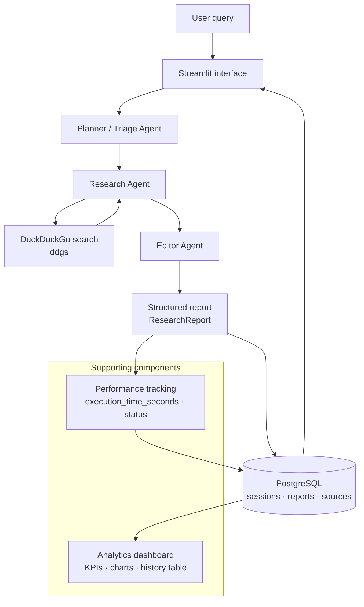

Per-query web search is a loop inside the Research node (`run_research_agent`
iterates `plan.search_queries`). Note: per-query LLM re-summarization is
intentionally bypassed in `agents/research_agent.py` for latency — the collected
result titles and URLs are passed to the Editor, which performs the synthesis.

---

## Technology Stack

| Layer | Technologies |
|---|---|
| Programming Language | Python 3.10+ |
| AI and Agent Framework | LangGraph 0.6.5, LangChain 0.3.27, `langchain-community`, `langchain-ollama` |
| LLM | Ollama + Qwen3 (`qwen3:4b` default), `ollama` client 0.5.3 |
| Web Search | DuckDuckGo via `ddgs` 9.14.4 |
| Backend and Data Layer | SQLAlchemy 2.0.43 (ORM), `psycopg2-binary` 2.9.10, pandas 2.3.1 |
| Database | PostgreSQL (SQLite supported as a dev fallback) |
| User Interface | Streamlit 1.46.1, Altair 6.2.1 / Vega-Lite (status chart), `st.bar_chart` |
| Validation and Testing | Pydantic 2.11.7, `python-dotenv` 1.1.1, standalone test modules under `tests/` |

---

## Application Screenshots

### Home page

The topic input and sidebar with the active model, Ollama host, and pipeline info.

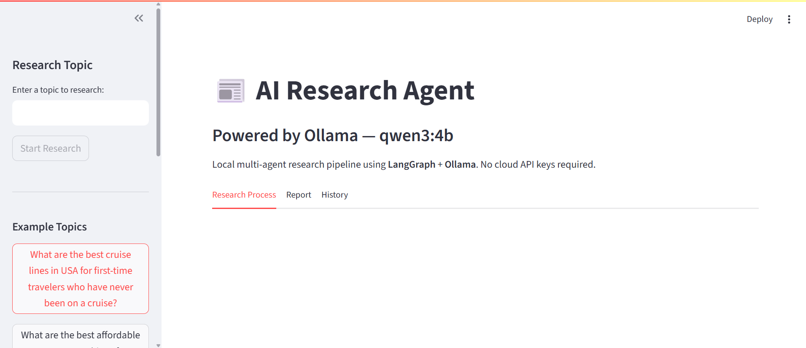

### Research workflow

Live per-node progress as the pipeline plans and retrieves from the web.

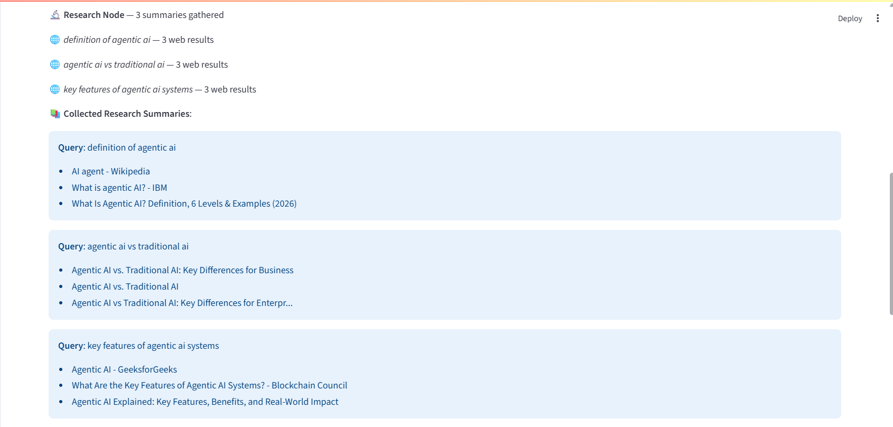

Planning and search nodes in detail:

| Planner node | Editor node |
|---|---|
| 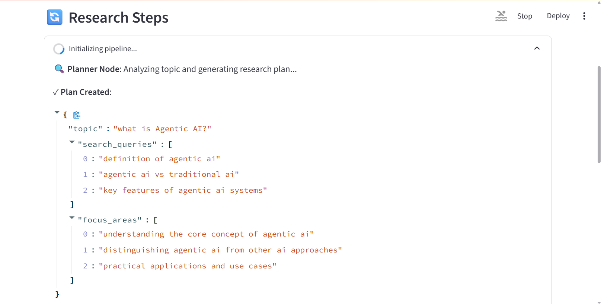 | 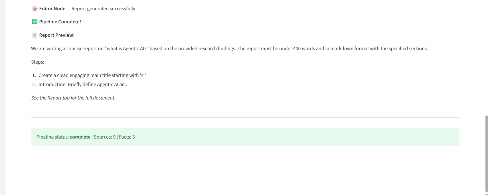 |

### Generated research report

The structured Markdown report with its metadata panel and download button.

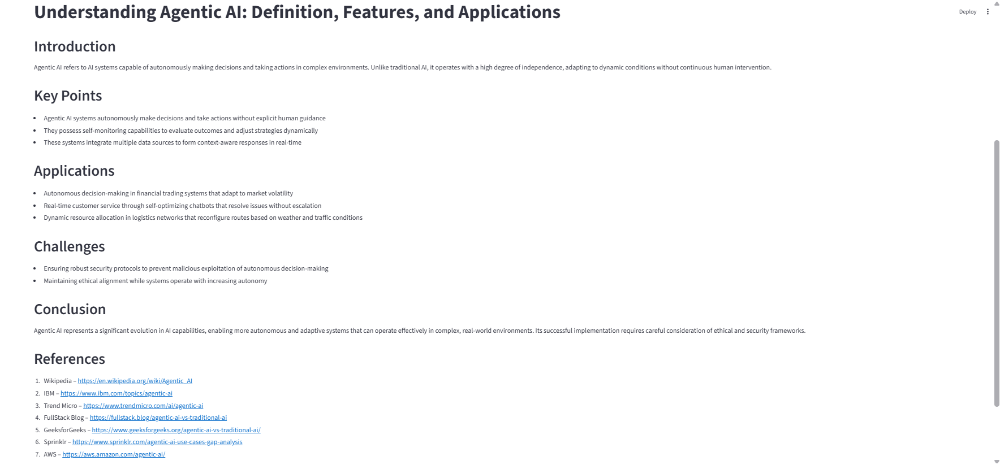

### Analytics dashboard

KPI overview read directly from PostgreSQL:

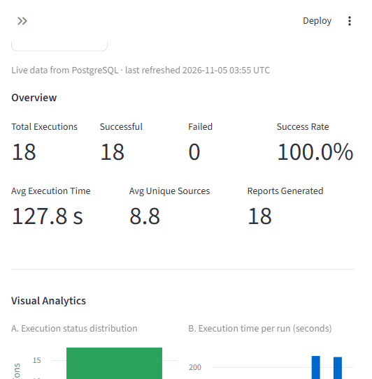

### Execution performance charts

Chart A (status distribution) and Chart B (execution time per run):

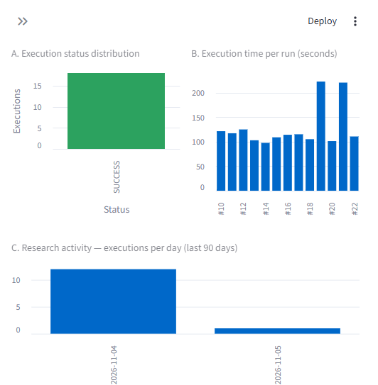

Chart C (daily research activity) and Chart D (unique sources per execution):

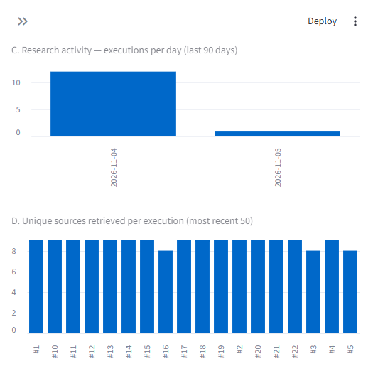

### Research history

Saved sessions for review and download:

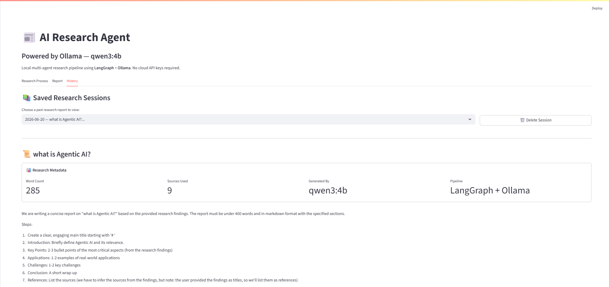

The filterable execution-history table inside the Analytics tab:

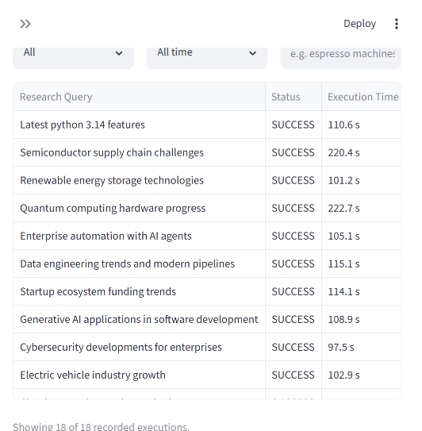

Full dashboard:

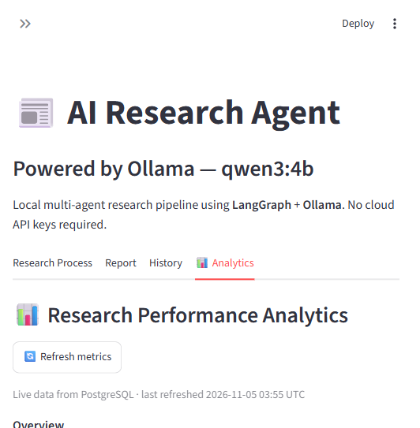

---

## Performance Monitoring and Evaluation

Every run records its timing and status. The analytics dashboard and the table
below read the same service functions (`database/database.py`) — no value is
hardcoded.

Verified local results at the time of writing (18 recorded research executions):

| Metric | Result |
|---|---:|
| Total Executions | 18 |
| Successful Executions | 18 |
| Failed Executions | 0 |
| Success Rate | 100% |
| Average Execution Time | 127.85 seconds |
| Average Unique Sources | 8.83 |
| Reports Generated | 18 |

Notes on interpretation:

- **Average execution time is computed over 13 timed records.** Five legacy
  rows pre-date performance tracking and have no `execution_time_seconds`
  value; `get_average_execution_time` excludes them with a SQL `IS NOT NULL`
  filter.
- **No historical timing values were fabricated or backfilled.** The five
  untimed rows are shown as `—` in the dashboard, not estimated.
- **Average unique sources** is `159` distinct source URLs across the 18 runs
  (`COUNT(DISTINCT url)`), i.e. `8.83` per run.
- **These are observations from local testing, not production guarantees.**
  Latency and success depend on hardware, model choice, network access, and
  search-engine behaviour. Individual local runs ranged from about 98s to 223s.
- **The system has not undergone production-scale or concurrent load testing.**

---

## Project Structure

```text
RESEARCH_AGENT/
├── agents/               # triage (planner), research, editor agent logic
├── benchmarks/           # benchmark runner and result CSVs/logs
├── config/               # ResearchConfig (dataclass, env-backed DATABASE_URL)
├── database/             # SQLAlchemy models, engine, persistence, metrics queries
├── generation/           # Ollama client and generation helpers (text/JSON/stream)
├── graph/                # LangGraph StateGraph build + pipeline runner
├── logs/                 # log output directory
├── schemas/              # Pydantic models (ResearchPlan, ResearchReport) and state
├── screenshots/          # documentation images (tracked)
├── tests/                # standalone verification suites
├── tools/                # DuckDuckGo web_search tool
├── ui/                   # Streamlit components and analytics dashboard
├── .env.example          # configuration template (tracked)
├── .env                  # real credentials (git-ignored, never committed)
├── app.py                # Streamlit entry point and pipeline orchestration
└── requirements.txt      # pinned dependencies
```

Responsibilities of the important modules:

- **`app.py`** — loads `.env`, checks Ollama, initializes the DB, runs the
  pipeline with progress/chunk callbacks, times execution, and persists both
  successful and failed runs.
- **`graph/workflow.py`** — defines `GraphState` and the three-node graph.
- **`agents/*`** — the planner, research, and editor logic (plain functions,
  invoked by the graph nodes).
- **`database/database.py`** — ORM models, session/engine singletons, idempotent
  schema initialization, `save_session`, history accessors, and metric
  aggregations; sanitizes credentials out of stored error messages.
- **`ui/analytics.py`** — the dashboard; contains no SQL, only presentation.

---

## Installation and Setup

Windows-friendly commands. Adjust the clone path/branch as needed.

**1. Clone and create a virtual environment**

```powershell
git clone https://github.com/Reddiah16/AI-Research-Agent.git
cd AI-Research-Agent

python -m venv venv
.\venv\Scripts\activate

pip install -r requirements.txt
```

**2. Configure PostgreSQL**

Create a database (for example `ai_research_agent`) on your PostgreSQL server.
Tables are created automatically on first run by `init_database()` — you only
need the database itself and a connection string.

**3. Configure environment**

```powershell
copy .env.example .env
```

Edit `.env` and set `DATABASE_URL` (see [Environment Variables](#environment-variables)).
Never commit `.env`.

**4. Install and configure Ollama, then pull the model**

Install Ollama (https://ollama.com) and make sure it is running locally on
`http://localhost:11434`, then:

```powershell
ollama pull qwen3:4b
```

If you prefer a different Qwen3 size, update `llm_model` in `config/config.py`
to match what you pulled.

---

## Environment Variables

Only one value is read from the environment today: `DATABASE_URL`. Ollama host,
model, search, and temperature settings are defaults in `config/config.py`.

`.env` (placeholder format shown; replace with your own values — do not use the
example placeholders verbatim):

```dotenv
DATABASE_URL=postgresql://<db_user>:<db_password>@<host>:5432/<database_name>
```

- `.env` holds real credentials and **must never be committed**. It is excluded
  by `.gitignore` (`.env`, `.env.*`, with only `.env.example` tracked).
- If `DATABASE_URL` is missing or empty, `database.get_engine()` raises an
  actionable configuration error instead of attempting a connection, and the
  dashboard shows setup guidance rather than a generic database failure.

---

## Running the Application

```powershell
.\venv\Scripts\activate
streamlit run app.py
```

Ollama must be running and reachable at the configured host. The app opens the
Streamlit UI with four tabs: **Research Process**, **Report**, **History**, and
**Analytics**.

---

## Testing

The suites are standalone scripts (run directly, not via a test runner):

```powershell
python tests/test_analytics_dashboard.py
python tests/test_metrics_persistence.py
python tests/test_performance_tracking.py
```

Verified results:

| Suite | Result | Covers |
|---|---|---|
| `test_analytics_dashboard.py` | 9/9 passing | KPI formatting, status-chart edge cases (SUCCESS-only, FAILED-only, empty), isolated per-section error boundaries |
| `test_metrics_persistence.py` | 7/7 passing | Session/report/source persistence, idempotent `run_id` writes, error-message credential sanitization |
| `test_performance_tracking.py` | 6/6 passing | Execution timing and SUCCESS/FAILED status recording |

`tests/test_web_search.py` additionally exercises the DuckDuckGo search tool.
The three results above are the suites verified during this project's testing;
no other test outcomes are claimed.

---

## Future Improvements

The following are planned enhancements and are **not currently implemented**:

- **FastAPI backend** — the application runs as a local Streamlit UI; no REST
  API service exists today.
- **Redis caching** — no caching layer is in place.
- **Parallel research** — queries are processed sequentially in the Research
  node; fan-out/parallel retrieval is future work.
- **Authentication** — the app has no user accounts or access control.
- **Advanced research evaluation** — relevance/quality scoring of reports is not
  yet implemented.

---

## License

Distributed under the MIT License. See [LICENSE](LICENSE) for details.
