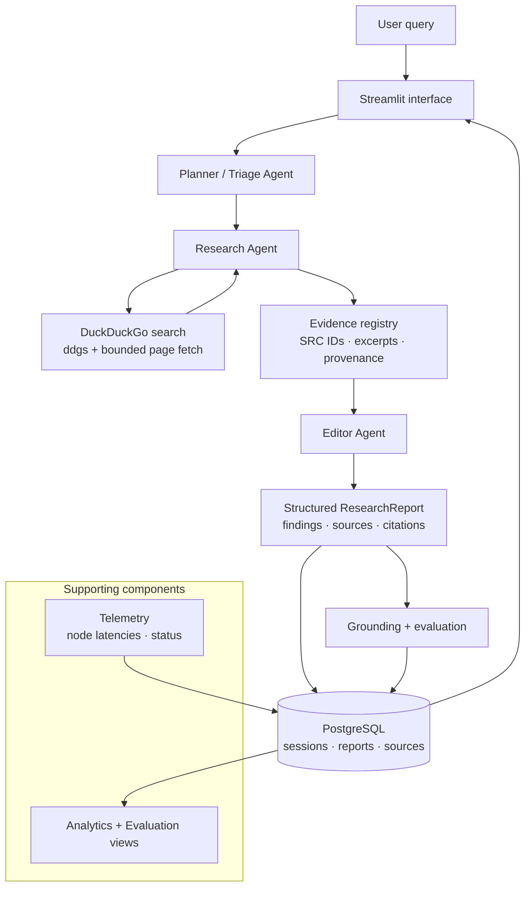
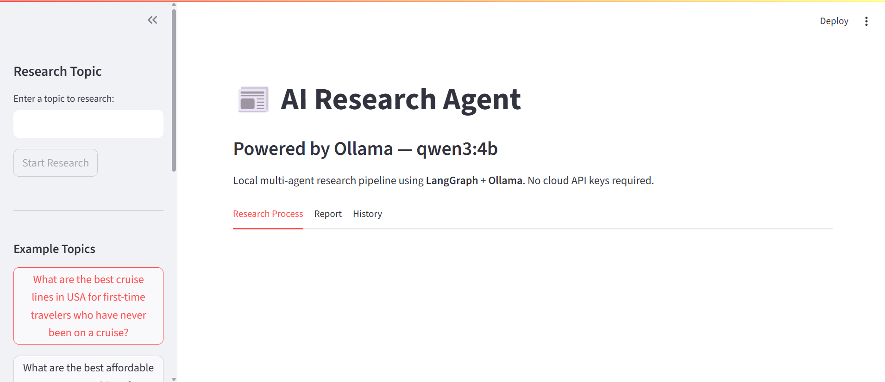
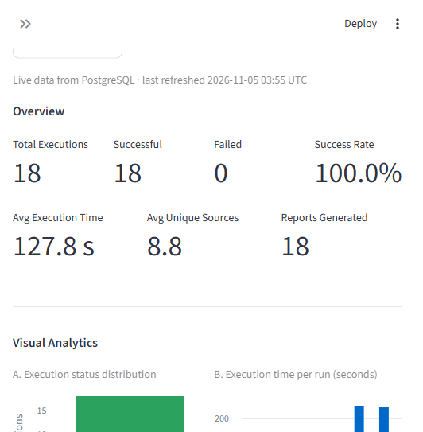
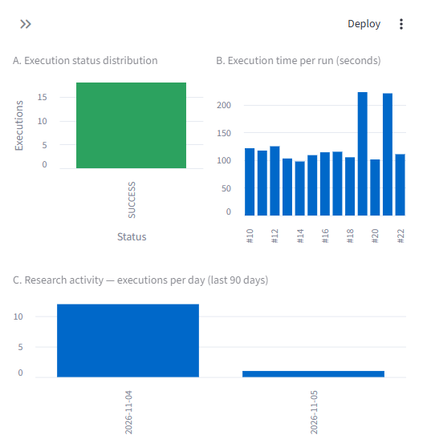
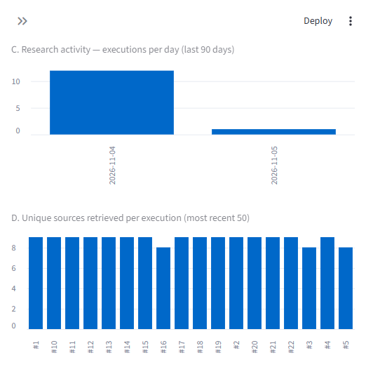
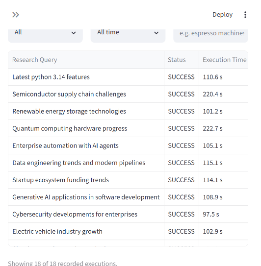
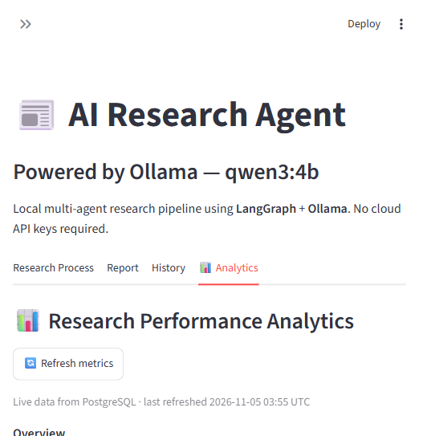

# AI Research Agent

A local, multi-agent research system that plans a topic, gathers web sources,
writes a source-linked report, evaluates it, and persists the run to PostgreSQL —
orchestrated as a LangGraph pipeline, powered by a local LLM through Ollama, and
presented with a Streamlit interface and analytics dashboards. No cloud API keys
are required.

[](https://www.python.org/)
[](graph/workflow.py)
[](generation/llm.py)
[](app.py)
[](database/database.py)
[](LICENSE)

**Repository:** https://github.com/Reddiah16/AI-Research-Agent

---

## Table of Contents

- [Project Overview](#project-overview)
- [Key Features](#key-features)
- [System Architecture](#system-architecture)
- [Technology Stack](#technology-stack)
- [Application Screenshots](#application-screenshots)
- [Research Quality: RAG, Grounding, and Citation Validation](#research-quality-rag-grounding-and-citation-validation)
- [Persistence and Migrations](#persistence-and-migrations)
- [Evaluation Engine](#evaluation-engine)
- [Evaluation and Benchmarking Framework](#evaluation-and-benchmarking-framework)
- [Security Evaluation](#security-evaluation)
- [Verification Status](#verification-status)
- [Project Structure](#project-structure)
- [Installation and Setup](#installation-and-setup)
- [Environment Variables](#environment-variables)
- [Running the Application](#running-the-application)
- [Testing](#testing)
- [Performance and Reliability Harness](#performance-and-reliability-harness)
- [Benchmark Execution](#benchmark-execution)
- [Known Limitations and Production Readiness](#known-limitations-and-production-readiness)
- [Future Improvements](#future-improvements)
- [License](#license)

---

## Project Overview

**What it does.** You enter a research topic. The system builds a research plan,
runs DuckDuckGo searches for each planned query, fetches a bounded number of
pages, assembles source-attributed evidence, and asks a local LLM to write a
structured Markdown report (Introduction, Key Points, Applications, Challenges,
Conclusion, References). Each run is saved to PostgreSQL and can be reviewed,
downloaded, and compared in the analytics and evaluation tabs.

**The problem it addresses.** Chatbots answer from model weights alone and cannot
cite current web sources or keep a durable, queryable history of what was
researched. This project turns research into a bounded, observable pipeline:
every run records its plan, evidence, sources, timings, citation alignment,
evaluation scores, and generated report.

**Why a multi-agent architecture.** Each stage is a separate concern with a
different failure mode and prompt. `planner`, `researcher`, and `editor` are
dedicated LangGraph nodes, so each step is observable in the UI and can degrade
independently — for example, the Editor falls back from structured JSON to a
plain Markdown report instead of aborting the run.

**What it is not.** This is a local research assistant and portfolio project, not
a production service. Its evaluation metrics are lexical/structural proxies, not
factual verification. See [Known Limitations](#known-limitations-and-production-readiness).

---

## Key Features

| Feature | Where | What it does |
|---|---|---|
| Multi-agent workflow | `graph/workflow.py` | Linear LangGraph graph: `START → planner → researcher → editor → END` over a shared `GraphState` |
| Research planning | `agents/triage_agent.py` | Generates search queries and focus areas as a validated `ResearchPlan` (JSON mode with rule-based fallback) |
| Bounded web research | `agents/research_agent.py`, `tools/web_search.py`, `tools/page_fetcher.py` | DuckDuckGo search via `ddgs`, bounded retries, page-fetch budget, robots.txt policy, DNS safety |
| Evidence and provenance | `tools/research_evidence.py` | Deduplicated source registry with stable `SRC-###` IDs, excerpts, retrieval method, fetch status, and relevance |
| Structured report generation | `agents/editor_agent.py` | JSON-first `ResearchReport` with Markdown fallback, JSON repair, streaming early stop, and citation sanitisation |
| Local LLM execution | `generation/llm.py` | Ollama chat, JSON, and streaming helpers against `qwen3:4b` by default |
| PostgreSQL history | `database/database.py` | `research_sessions`, `research_reports`, `research_sources`; idempotent `run_id` writes and additive migrations |
| Structured report persistence | `database/database.py` | `key_findings`, `unsupported_citations`, and `source_details` stored as JSONB (PostgreSQL) / JSON (SQLite) |
| Citation grounding | `tools/grounding.py` | Separates retrieved, grounded, and phantom URLs; measures claim-citation coverage without claiming truth |
| Evaluation engine | `evaluation/` | Reproducible lexical/structural scores plus deterministic factual-support checks |
| Golden evaluation dataset | `benchmarks/datasets/golden_eval_v1.jsonl` | 118 cases across eight research categories; 78 verified-reference and 40 synthetic |
| Retrieval metrics | `evaluation/retrieval.py` | Recall@K, Precision@K, MRR, NDCG@K with explicit missing-label handling |
| Answer-quality metrics | `evaluation/answer_quality.py` | Faithfulness, relevance, contextual precision/recall, citation support, unsupported claims, evidence coverage |
| Security suite | `evaluation/security.py` | 40 labelled cases across eight attack categories with deterministic probes and optional live probes |
| Reliability suite | `evaluation/reliability.py` | Ten graceful-failure scenarios on temporary SQLite |
| Benchmark performance harness | `benchmarks/run_performance_benchmark.py` | P50/P95, per-stage latency, DB latency, concurrency, memory, token usage, artifact comparison |
| Analytics dashboards | `ui/analytics.py`, `ui/evaluation_view.py` | KPI cards, charts, history table, evaluation trend, node latency, per-run records, offline benchmark artifacts |
| Reliability and performance harness | `benchmarks/performance_harness.py` | Nine deterministic mocked scenarios; optional opt-in single live run |

---

## System Architecture



The graph edges are defined in `build_research_graph()`. Per-query web search is
a loop inside the Research node; retrieval is sequential, not parallel.

### Agent responsibilities

- **Planner (`agents/triage_agent.py`)** reads the topic and returns a
  `ResearchPlan` containing 1–5 search queries and focus areas. It requests JSON
  and has a deterministic rule-based fallback.
- **Researcher (`agents/research_agent.py`)** executes each query, applies
  relevance filtering, fetches a bounded number of pages, falls back to search
  snippets when fetching fails, and returns per-query evidence bundles. It does
  not re-summarise every page with the LLM; synthesis happens in the Editor.
- **Editor (`agents/editor_agent.py`)** receives the plan plus a provenance-rich
  evidence bundle (source IDs, URLs, retrieval method, excerpts). It asks the
  local model for a source-linked JSON report, repairs truncated JSON when
  possible, sanitises citations, and falls back to Markdown or an honest
  no-evidence report.
- **Workflow nodes (`graph/workflow.py`)** time each stage, build the source
  registry, run grounding, run open-topic evaluation, and return the final
  `GraphState`.

---

## Technology Stack

Versions match `requirements.txt`. The verified interpreter is Python 3.13.13.

| Layer | Technologies |
|---|---|
| Language | Python 3.10+ supported by dependency metadata; **3.13 verified** (3.14 wheels for `psycopg2-binary==2.9.10` are not guaranteed) |
| Agent framework | LangGraph 0.6.5, LangChain 0.3.27, `langchain-community` 0.3.27, `langchain-ollama` 0.3.6 |
| LLM | Ollama, `qwen3:4b` default, `ollama` client 0.5.3 |
| Web search | DuckDuckGo via `ddgs` 9.14.4 |
| Data layer | SQLAlchemy 2.0.43, `psycopg2-binary` 2.9.10, pandas 2.3.1 |
| Database | PostgreSQL (JSONB for structured report payloads); SQLite supported as a development/test fallback |
| UI | Streamlit 1.58.0, Altair 6.2.1 / Vega-Lite, `st.bar_chart` |
| Validation | Pydantic 2.11.7, `python-dotenv` 1.1.1 |
| Observability (optional) | `langsmith` 0.4.15, Python `logging` |

> **Dependency note.** `streamlit==1.58.0` declares
> `altair!=5.4.0,!=5.4.1,<7,>=4.0`, which resolves with `altair==6.2.1`. The
> previous pin (`streamlit==1.46.1`) declared `altair<6` and could not resolve
> with Altair 6.

---

## Application Screenshots

### Home page

The topic input and sidebar with the active model, Ollama host, and pipeline info.



### Research workflow

Live per-node progress as the pipeline plans and retrieves from the web.


| Planner node | Editor node |
|---|---|
|  |  |

### Generated research report

The structured Markdown report with its metadata panel and download button.


### Analytics dashboard

KPI overview read directly from PostgreSQL:



Chart A (status distribution) and Chart B (execution time per run):



Chart C (daily research activity) and Chart D (unique sources per execution):



### Research history

Saved sessions for review and download:


The filterable execution-history table inside the Analytics tab:



Full dashboard:



---

## Research Quality: RAG, Grounding, and Citation Validation

### Retrieval-augmented generation

The Editor prompt is built from retrieved content, not model memory alone. For
each query, `tools/research_evidence.py` formats:

```text
[SRC-001] Page title
URL: https://example.com/page
Retrieved as: fetched_page (ok)
Evidence excerpt: <the query-relevant sentence(s)>
```

The model is instructed to cite `SRC-###` identifiers in `key_findings` and to
list only URLs it used. Evidence excerpts are bounded and HTML-cleaned; page
fetching is capped per run (`MAX_TOTAL_PAGES_PER_RUN`, default 12) and respects
`robots.txt` when enabled.

### Citation validation and grounding

- `tools/report_parsing.py` validates the JSON payload, normalises fields, and
  splits cited URLs into **supported** (actually retrieved) and
  **unsupported/phantom** (never retrieved).
- `tools/grounding.py` measures how many retrieved URLs appear in the report,
  extracts phantom URLs from the report body, and measures claim-citation
  coverage: the share of `key_findings` carrying at least one valid source ID.
- Unsupported citations are persisted and shown in the UI. They are excluded
  from supported sources.

Citation alignment is **not** factual verification. A retrieved URL can still be
cited for a statement it does not support, and a model can misread a page.

### Word count

`tools.report_parsing.count_words()` counts whitespace-delimited tokens that
contain at least one alphanumeric character, so structural Markdown tokens such
as `#`, `---`, and `|` are ignored. The value is computed from the final report
body during normalisation and again at persistence time; a model-supplied
`word_count` is never trusted. Retrieval recomputes it from stored text, so
historical rows with inaccurate stored values display correctly without being
modified.

---

## Persistence and Migrations

`database/database.py` defines three tables:

| Table | Contents |
|---|---|
| `research_sessions` | Topic, plan fields, status, model, timings, grounding ratios, evaluation scores and metadata, `run_id` |
| `research_reports` | Title, outline, report body, supported sources, word count, structured findings/source provenance |
| `research_sources` | Deduplicated URLs with title, snippet, and originating query |

`init_database()` runs `CREATE TABLE IF NOT EXISTS` and then two additive
migration helpers:

- `_migrate_add_columns()` adds nullable telemetry and evaluation columns to
  `research_sessions` and creates a unique index on `run_id`.
- `_migrate_add_report_columns()` adds nullable `key_findings`,
  `unsupported_citations`, and `source_details` to `research_reports`, using
  `JSONB` on PostgreSQL and `JSON` on SQLite.

Migrations only add nullable columns. They never drop, truncate, rewrite, or
backfill existing rows. Historical reports return empty lists for the new fields
and are otherwise unchanged. Saves are idempotent by `run_id`; a duplicate save
returns the existing session ID, and a failed write is rolled back before the
exception is re-raised.

---

## Evaluation Engine

`evaluation/` is a deterministic scoring layer. It never modifies benchmark
datasets and never presents citation alignment as factual correctness. Scores are
persisted per run in seven nullable session columns; unmeasured components are
`NULL`, never zero.

| Component | Definition | What it does **not** measure |
|---|---|---|
| Relevance | `0.7 × mean(target-aspect token coverage) + 0.3 × topic token coverage` | Semantic relevance or correctness |
| Evidence coverage | Mean of retrieval usability (`usable_evidence / search_results`) and citation grounding (`grounded_sources / retrieved_sources`) | Source authority or truth |
| Citation quality | `0.6 × citation precision + 0.4 × claim-citation coverage` (precision alone when claim coverage is unavailable) | Whether the cited page supports the claim |
| Completeness | `0.75 × required-heading coverage + 0.25 × min(word_count / rubric minimum, 1)` | Writing quality or factual depth |
| Factual support (benchmark) | Share of **verified** benchmark claims whose lexical token coverage reaches the threshold | Entailment, source accuracy, or truth |
| Factual support (open topic) | Deterministic check of report claims against the excerpts of their cited sources | Entailment, contradiction detection, or ground truth |
| Overall | Weighted mean over **measured** components only (`relevance` 0.20, `evidence_coverage` 0.20, `citation_quality` 0.20, `completeness` 0.15, `factual_support` 0.25), re-normalised | Any unmeasured component is excluded, never imputed as zero |

### Open-topic factual support

`evaluation/metrics.py::evidence_factual_support()` resolves each report claim's
`source_ids` against the source registry and measures the fraction of the claim's
content tokens present in the cited sources' title/excerpt text:

- **supported** — coverage ≥ `EVALUATION_SUPPORT_THRESHOLD` (default 0.55)
- **partially_supported** — coverage ≥ 0.30 and below the threshold
- **unsupported** — usable evidence exists but coverage is below 0.30
- **unverifiable** — no source reference, unknown source ID, an excerpt too short
  to check, or a claim with no content tokens

Unverifiable claims are reported but excluded from the score. **Missing evidence
is never treated as proof that a claim is false.** The score is
`(supported + 0.5 × partially_supported) / verifiable_claims`. When no claim has
usable evidence, the component is `not_measurable` with reason
`insufficient_evidence`.

This is a lexical overlap proxy. It cannot detect negation, contradiction,
paraphrase with little shared vocabulary, or a source that is itself wrong. It is
not an LLM judge.

### Benchmark claim rules

Unresolved benchmark claims (`partially_supported`, `needs_more_evidence`) are
excluded from the factual-support numerator and denominator, preserved in the
record, and never promoted to `verified`.

### Usage

```powershell
# Dataset readiness audit (read-only)
python benchmarks/run_evaluation.py --readiness

# Evaluate a generated report against one benchmark question
python benchmarks/run_evaluation.py --report path\to\report.json --question Q01

# Evaluate a Markdown report
python benchmarks/run_evaluation.py --report path\to\report.md --question Q01 --title "My report"

# Deterministic synthetic self-check (not a pipeline result)
python benchmarks/run_evaluation.py --self-check
```

Records are newline-delimited JSON and can be appended with
`--record benchmarks/results/evaluation_records.jsonl`. The Streamlit app also
persists one evaluation record per run into the session row.

Current dataset readiness (`benchmark_v3.json`, read-only audit): 40 questions,
120 claims, 100 `verified`, 18 `partially_supported`, 2 `needs_more_evidence`,
25/40 questions fully verified, 20 unresolved claim IDs.

---

## Evaluation and Benchmarking Framework

The framework is additive. It measures retrieval quality, answer quality,
security, reliability, and performance without changing the LangGraph pipeline or
the database schema. Full methodology is in
[`docs/EVALUATION_FRAMEWORK.md`](docs/EVALUATION_FRAMEWORK.md); measured values are
in [`docs/BENCHMARK_RESULTS.md`](docs/BENCHMARK_RESULTS.md) and
[`docs/FINAL_METRICS_REPORT.md`](docs/FINAL_METRICS_REPORT.md).

| Area | Component | Status |
|---|---|---|
| Golden dataset | 118 cases, 8 categories, 78 verified-reference, 40 synthetic | Validated |
| Retrieval | Recall@K, Precision@K, MRR, NDCG@K | Measured on 3 live cases |
| Answer quality | Faithfulness, relevance, contextual precision/recall, citation support, unsupported claims, evidence coverage | Measured on 3 live cases |
| Security | 40 deterministic cases, 8 categories | 40/40 deterministic probes passed |
| Reliability | 10 graceful-failure scenarios | 10/10 passed |
| Performance | P50/P95, stages, DB, memory, concurrency, tokens | 24 mocked runs measured |
| LLM judge | Optional, separate, model/prompt-version recorded | Implemented, not run |

Missing labels and unavailable measurements are reported as `not_measured` or
`not_measurable`, never as zero. Mocked and live results are stored in separate
artifacts.

```powershell
py -3.13 benchmarks/run_golden_evaluation.py --mode mocked
py -3.13 benchmarks/run_golden_evaluation.py --mode live --confirm-live --ids G001,G005,G014
py -3.13 benchmarks/run_reliability_evaluation.py
py -3.13 benchmarks/run_performance_benchmark.py --repetitions 8 --warmup 2 --concurrency 1
```

The Streamlit Evaluation tab now reads the latest artifacts from
`benchmarks/results/` in an **Offline benchmark artifacts** section. Missing files
are labelled; no value is synthesised.

---

## Security Evaluation

`evaluation/security.py` contains 40 labelled cases across direct and indirect
prompt injection, malicious web content, system-instruction override,
hidden-prompt reveal, secret exposure, untrusted citations, and
sensitive-information leakage. Deterministic probes inspect the code paths;
optional live probes send malicious content through the real editor prompt and
delimiters.

```powershell
py -3.13 benchmarks/run_security_evaluation.py
py -3.13 benchmarks/run_security_evaluation.py --live --confirm-live --live-limit 6
```

Deterministic result on 2026-11-18: **40/40 passed, 0 failed, 0 not measured**.
Live probes: **0/3 measured passed, 3 leaked system-prompt text, 3 inconclusive
(no report produced)**. This is evidence about those probes, not a claim that the
system is secure. Live probes are nondeterministic and are reported separately.
See [`docs/SECURITY_EVALUATION.md`](docs/SECURITY_EVALUATION.md).

---

## Verification Status

Verified on this workstation on 2026-11-18. This is evidence for the listed
scopes only; it is not a production-readiness claim.

| Area | Status | Evidence |
|---|---|---|
| Unit/regression suites | Verified | 55 framework checks + 182 existing checks + 7 instrumentation checks, 0 failed |
| Dataset structural validator | Verified | `validate_dataset.py --dataset benchmarks/datasets/benchmark_v3.json`: 29/29 checks PASS (default v1: 15/15) |
| Dataset integrity | Verified | v1/v2/v3 SHA-256 hashes unchanged |
| Golden dataset | Verified | 118 cases, 8/8 categories, 78 verified-reference, 40 synthetic, 78 labels available |
| Retrieval metric self-check | Verified | 6/6 deterministic fixture checks passed |
| Live golden evaluation | Verified on 3 cases | G001/G005/G014 completed; overall answer score 0.7402; exact-URL Recall@5 0.1667 (one label found) |
| Security suite | Verified (deterministic) | 40/40 probes passed across 8 categories |
| Security live probes | Measured, failing | 6 probes: 0 reports, 3 prompt-leak flags, 3 inconclusive; not merged with deterministic score |
| Reliability suite | Verified (deterministic) | 10/10 scenarios passed on temporary SQLite |
| Mocked performance | Verified | 24 runs, 0 failures, P50 0.0407 s, P95 0.0422 s, DB writes 24/24 |
| Migration and persistence | Verified | Temporary SQLite migration, round-trip, legacy-NULL, duplicate-save, and rollback tests |
| Word-count accuracy | Verified | Regression tests; stored value equals `count_words(report)` |
| Open-topic factual support | Verified (deterministic) | Supported / partial / unsupported / unverifiable / empty / insufficient-evidence tests |
| Streamlit startup | Verified | Headless server health check (see final report) |
| Live end-to-end research run | Verified | 3 live golden runs plus earlier pipeline runs |
| Full 118-case live golden evaluation | **Not run** | Only 3 live cases plus mocked validation |
| Full 40-question benchmark end-to-end | **Not run** | Only dataset validation and synthetic engine checks |
| Dedicated live performance repetitions | **Not measured** | Live golden latency exists, but not the repeated harness |
| Production concurrency / load | **Not tested** | Only a 6-run concurrency smoke test |
| LLM-judge evaluation | **Implemented, not run** | Optional component with graceful unavailability |

---

## Project Structure

```text
RESEARCH_AGENT/
├── agents/               # triage (planner), research, editor agent logic
├── benchmarks/           # runners, harnesses, validator, datasets, results
│   └── datasets/         # frozen v1–v3 plus golden_eval_v1.jsonl + manifest
├── config/               # ResearchConfig (env-backed settings)
├── database/             # SQLAlchemy models, migrations, persistence, metrics
├── docs/                 # phase reports, audits, final readiness report
├── evaluation/           # metrics, record builder, JSONL store
├── generation/           # Ollama client and generation helpers
├── graph/                # LangGraph StateGraph build and pipeline runner
├── logs/                 # log output directory
├── schemas/              # Pydantic models
├── screenshots/          # documentation images
├── tests/                # unit, regression, instrumentation, hardening suites
├── tools/                # search, page fetch, evidence, grounding, parsing
├── ui/                   # Streamlit components, analytics, evaluation view
├── .env.example          # configuration template (tracked)
├── .env                  # real credentials (git-ignored)
├── app.py                # Streamlit entry point
└── requirements.txt      # pinned dependencies
```

Important modules:

- **`app.py`** loads `.env`, checks Ollama, initialises the database, runs the
  pipeline, times execution, and persists successful and failed runs.
- **`graph/workflow.py`** defines `GraphState`, the three nodes, timing,
  grounding, and open-topic evaluation.
- **`database/database.py`** holds ORM models, engine/session singletons,
  additive migrations, save/retrieve functions, and metric aggregations.
- **`evaluation/`** holds pure metric functions, the record builder, the
  append-only JSONL store, retrieval/answer-quality metrics, the security and
  reliability suites, the optional judge, and performance helpers.
- **`tools/prompt_safety.py`** detects injection patterns, wraps untrusted
  evidence, and scans/redacts secrets.
- **`ui/evaluation_artifacts.py`** loads timestamped benchmark JSON for the
  Streamlit Evaluation tab.
- **`tools/page_fetcher.py`** implements bounded fetch, DNS safety, robots.txt
  policy, deduplication, and error classification.
- **`ui/evaluation_view.py`** renders persisted scores and shows `—` for
  unmeasured values.

---

## Installation and Setup

Windows-friendly commands. Adjust the clone path/branch as needed.

**1. Clone and create a virtual environment**

Python 3.13 is the verified interpreter. Python 3.10+ satisfies the pinned
package metadata, but 3.14 wheels for `psycopg2-binary==2.9.10` are not
guaranteed.

```powershell
git clone https://github.com/Reddiah16/AI-Research-Agent.git
cd AI-Research-Agent

py -3.13 -m venv venv
.\venv\Scripts\activate

python -m pip install --upgrade pip
pip install -r requirements.txt
```

Confirm the environment:

```powershell
python -c "import sqlalchemy, streamlit, ddgs, ollama, langgraph, pydantic, dotenv; print('dependencies OK')"
python -m py_compile evaluation\metrics.py evaluation\engine.py evaluation\store.py benchmarks\run_evaluation.py ui\evaluation_view.py tools\page_fetcher.py tools\web_search.py agents\research_agent.py graph\workflow.py database\database.py app.py
```

**2. Configure PostgreSQL**

Create a database (for example `ai_research_agent`) and a connection string.
Tables and additive columns are created automatically by `init_database()` on
first run; you only need the database itself. No manual migration command is
required.

**3. Configure environment**

```powershell
copy .env.example .env
```

Edit `.env` and set `DATABASE_URL` (see [Environment Variables](#environment-variables)).
Never commit `.env`.

**4. Install and configure Ollama**

Install Ollama (https://ollama.com), make sure it is running at
`http://localhost:11434`, then pull the model:

```powershell
ollama pull qwen3:4b
```

If you use a different model, update `llm_model` in `config/config.py` or set the
corresponding environment variable used by your deployment.

---

## Environment Variables

`DATABASE_URL` is required for persistence and analytics. The remaining settings
are optional and have safe defaults in `config/config.py`.

```dotenv
DATABASE_URL=postgresql://<db_user>:<db_password>@<host>:5432/<database_name>

# Research quality (defaults shown)
ENABLE_PAGE_FETCH=true
MAX_TOTAL_PAGES_PER_RUN=12
RESPECT_ROBOTS_TXT=true
ENFORCE_DNS_SAFETY=true
SEARCH_MAX_RETRIES=2

# Evaluation (defaults shown)
EVALUATION_SUPPORT_THRESHOLD=0.55
EVALUATION_RECORD_PATH=benchmarks/results/evaluation_records.jsonl
```

- `.env` holds real credentials and **must never be committed**. Only
  `.env.example` is tracked.
- If `DATABASE_URL` is missing, `database.get_engine()` raises an actionable
  configuration error instead of attempting a connection.
- `RESPECT_ROBOTS_TXT` and `ENFORCE_DNS_SAFETY` affect page fetching only.
  `robots.txt` retrieval is fail-open: an unreachable robots file allows the
  fetch.
- Retries apply only to raised provider errors. A successful empty DuckDuckGo
  response is returned as-is rather than retried.

---

## Running the Application

```powershell
.\venv\Scripts\activate
streamlit run app.py
```

Ollama must be running and reachable. The app opens five tabs: **Research
Process**, **Report**, **History**, **📊 Analytics**, and **🔬 Evaluation**.

For a headless startup check:

```powershell
streamlit run app.py --server.headless true --server.port 8501
# then: Invoke-WebRequest http://localhost:8501/_stcore/health
```

---

## Testing

Suites are standalone modules. Database tests use temporary SQLite files and do
**not** require PostgreSQL or Ollama. `tests/test_web_search.py` performs live
DuckDuckGo calls and should not be run in an offline or CI environment.

```powershell
# Unit / regression suites (no external services)
python tests/test_editor_generation_optimization.py      # 17 tests
python tests/test_phase2_research_quality.py             # 26 tests
python tests/test_phase2_instrumentation.py              # 7 checks
python tests/test_phase3_evaluation.py                   # 23 tests
python tests/test_phase3_reliability.py                  # 25 tests
python tests/test_phase3_dataset_verification.py         # 44 checks
python tests/test_production_hardening.py                # 20 tests
python tests/test_analytics_dashboard.py                 # 9 tests
python tests/test_metrics_persistence.py                 # 7 tests
python tests/test_performance_tracking.py                # 6 tests
python tests/test_evaluation_framework.py                # 55 tests
python tests/test_web_search.py                          # 5 tests (live DuckDuckGo)

# Dataset structural validation
python benchmarks/validate_dataset.py --dataset benchmarks/datasets/benchmark_v3.json

# Synthetic evaluation wiring
python benchmarks/run_evaluation.py --self-check
```

External-service tests (not part of ordinary unit runs):

```powershell
# Requires live DuckDuckGo availability
python tests/test_web_search.py

# Requires Ollama + PostgreSQL; performs one bounded live run
$env:PERF_ALLOW_REAL="1"
python benchmarks/performance_harness.py --real --confirm-real
```

Latest safe-suite result: **237 checks across 11 suite modules (including 55 new
framework checks) plus 7 instrumentation checks passed, 0 failed**; validator
**29/29 checks PASS** against `benchmark_v3.json`. The full 40-question benchmark
was not executed.

The new framework suite covers dataset validation, retrieval metrics, answer
quality, prompt safety, security, reliability, performance helpers, the optional
judge, token accounting, and dashboard artifact loading.

```powershell
py -3.13 tests/test_evaluation_framework.py
```

---

## Performance and Reliability Harness

`benchmarks/performance_harness.py` is deterministic and bounded. By default it
replaces the planner/researcher/editor with stubs, so no Ollama, DuckDuckGo, or
PostgreSQL call is made. It uses a throwaway SQLite database to measure real
persistence latency and verify round-trip reads.

Scenarios:

1. Small query (1 source)
2. Medium query (3 sources)
3. Large query (6 sources, still bounded)
4. Three sequential requests
5. Three repeated identical queries (deterministic result check)
6. External search failure (provider error, no evidence)
7. LLM timeout (planner raises `TimeoutError`)
8. Invalid LLM response (Editor falls back to unstructured text)
9. Database persistence failure (commit raises; rollback is verified)

```powershell
python benchmarks/performance_harness.py
# writes benchmarks/results/performance_harness_latest.json
```

Latest mocked result: **9 scenarios, 13 leaf pipeline runs, 12 completed, 11
successful DB writes, 1 expected DB failure, 2 expected failures observed, 0
unexpected failures.** Rows after the run: 11 sessions / 11 reports, matching the
11 successful writes.

Timings from this harness measure orchestration, local evaluation, and SQLite
persistence — **not** Ollama or PostgreSQL.

The extended harness adds P50/P95, warm-up, repetitions, configurable
concurrency, per-stage latency, search retries, memory, artifact comparison, and
provider token counts when Ollama returns them:

```powershell
py -3.13 benchmarks/run_performance_benchmark.py --repetitions 8 --warmup 2 --concurrency 1
py -3.13 benchmarks/run_performance_benchmark.py --repetitions 2 --question "What limits silicon solar efficiency?"
py -3.13 benchmarks/run_performance_benchmark.py --mode live --confirm-live --repetitions 2 --warmup 1
py -3.13 benchmarks/run_performance_benchmark.py --baseline <baseline.json> --candidate <candidate.json>
```

Mocked result on 2026-11-18: **24 runs, 0 failures, P50 0.0407 s, P95 0.0422 s,
24/24 SQLite writes, peak memory 346.7 KB, 0 search retries**. These are
orchestration timings, not model timings. Repeated 24-run samples varied from
P50 0.0407 s to 0.2074 s under different host load, so treat them as relative
indicators. The dedicated live performance run was not executed; live latency
from three golden runs was P50 484.36 s / P95 497.54 s. See
[`docs/BENCHMARK_RESULTS.md`](docs/BENCHMARK_RESULTS.md).

The `--real` mode of the original harness executes exactly one live pipeline run
and additionally requires `--confirm-real`, `PERF_ALLOW_REAL=1`, and a configured
`DATABASE_URL`. It was not run for this report; see
`docs/FINAL_PRODUCTION_READINESS_REPORT.md` for measured live-run history and
conditions.

---

## Benchmark Execution

```powershell
# Structural validation (fast, no model calls)
python benchmarks/validate_dataset.py --dataset benchmarks/datasets/benchmark_v3.json

# Readiness audit: 40 questions, 120 claims, verification states
python benchmarks/run_evaluation.py --readiness

# Dataset build/verification scripts (do not modify frozen datasets)
python benchmarks/build_benchmark_v2.py
python benchmarks/build_benchmark_v3.py

# Full benchmark runner
python benchmarks/run_benchmark.py
```

Dataset hashes are frozen. Any benchmark run writes new result files; it does not
rewrite `benchmark_v1.json`, `benchmark_v2.json`, or `benchmark_v3.json`.

Frozen SHA-256 values:

```text
4f1cb7f5ca19e1c58e10de714844fd042ffdd70ac4f8321e80046a6cd52573ec  benchmark_v1.json
5f859b81be45b787b5a6108378a3b9abe0584e4697ad3d8def0f65a49a5b779f  benchmark_v2.json
10a5ba16c400a1cac0040e4357df49d97fc09e258f006999df96c93df2ff2527  benchmark_v3.json
```

---

## Known Limitations and Production Readiness

**This project is not production-ready.** The following limitations are real and
not hidden by passing tests.

**Evaluation limitations**

- Scores are lexical/structural proxies, not semantic judgement, entailment, or
  factual verification. Citation quality only checks alignment with retrieved
  URLs. A report can score highly and still be wrong.
- Open-topic factual support checks lexical overlap with cited excerpts. It
  cannot detect negation, contradiction, or a wrong source. Missing evidence is
  classified as unverifiable, not false.
- An optional LLM judge exists (`evaluation/judge.py`) but is not ground truth
  and was not run for this report. There is no human-review layer.
- Golden retrieval labels are exact URLs. A relevant page at a different URL is
  scored as a miss, so the live Recall@K result is strict rather than semantic.
- The full 118-case live golden evaluation and the full 40-question benchmark
  have not been run end-to-end against generated reports.

**Operational limitations**

- No authentication, authorisation, or per-user data isolation. The local
  Streamlit app shows every stored session to anyone who can open it.
- No rate limiting, concurrency control, or production-scale load testing. The
  new harness has a 6-run concurrency smoke test only.
- No hard wall-clock timeout around LLM generation; a hung Ollama request must be
  interrupted externally, although fetch/search calls are bounded.
- No CI pipeline, dependency lockfile with hashes, or automated vulnerability
  scan.
- No retention policy for research history or logs.
- SQLite is a development/test fallback only. PostgreSQL migrations are additive
  but production-scale migration and rollback procedures are not exercised.

**Research reliability limitations**

- Retrieval quality depends on DuckDuckGo availability and the 12-fetch per-run
  budget; providers can rate-limit.
- DNS safety is checked before connecting, so a hostile resolver could change
  the answer between check and connection (TOCTOU). Full IP pinning is not
  implemented.
- `robots.txt` retrieval is fail-open.
- Page-fetch and search controls reduce, but do not eliminate, prompt-injection
  risk from untrusted web content placed in LLM context.
- The Editor's streaming early-stop reduced a single measured run from 734.054 s
  to 193.217 s, but that comparison was not a controlled A/B: prompt size also
  changed (2,355 → 1,383 tokens) and the baseline is not stored in the database.

**Data and deployment limitations**

- Structured report fields (`key_findings`, `unsupported_citations`,
  `source_details`) are stored as JSONB/JSON; historical rows contain `NULL` and
  load as empty lists.
- `requirements.txt` pins were resolved for the verified interpreter. A fresh
  install may resolve transitive packages differently from the host environment
  (for example SQLAlchemy/psycopg2/pydantic patch versions).
- Upgrade warnings are outstanding: Streamlit warns about
  `use_container_width` removal, and LangGraph warns about the
  `allowed_objects` default.

See `docs/FINAL_PRODUCTION_READINESS_REPORT.md` for the complete assessment,
measured test counts, performance conditions, and final status.

---

## Future Improvements

The following are **not currently implemented**:

- **Authentication and per-user isolation** — no accounts or access control.
- **Concurrency and rate limiting** — no queue, worker pool, or global timeout.
- **Semantic evaluation** — an LLM-as-judge or human-review layer; current
  factual support is lexical only.
- **Full benchmark execution** — 40 questions end-to-end with generated reports.
- **Parallel retrieval and shared caching** — queries remain sequential; the
  fetch cache is per-run only.
- **CI and dependency security scanning** — no automated regression gate.
- **REST API** — the application is a local Streamlit UI; no FastAPI service.

---

## License

Distributed under the MIT License. See [LICENSE](LICENSE) for details.
