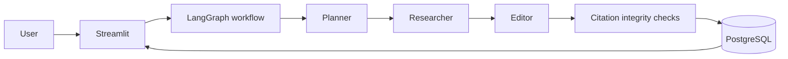
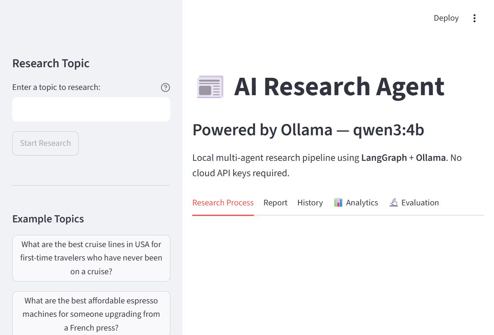
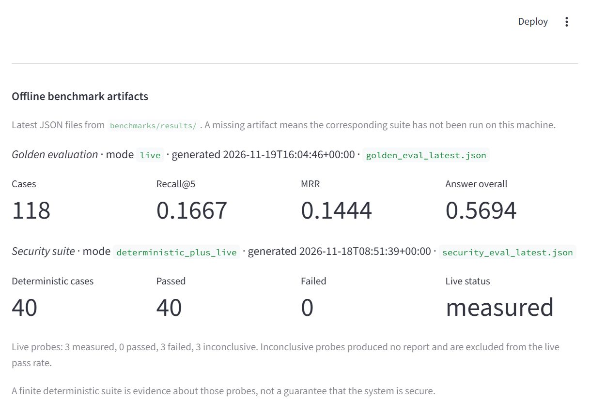

# AI Research Agent

A local multi-agent research assistant that plans, retrieves, and writes source-linked reports.

## Overview

AI Research Agent turns a topic into a structured report using a LangGraph pipeline and a local Ollama model. The Planner creates diverse search queries, the Researcher retrieves and ranks web evidence, and the Editor writes a cited report with deterministic evidence and citation checks. Runs are persisted to PostgreSQL and explored through a Streamlit interface.

## Key Features

- **Planner → Researcher → Editor** pipeline orchestrated with LangGraph.
- **Bounded retrieval** using DuckDuckGo, page fetching, deduplication, and deterministic source ranking.
- **Evidence selection** with source/character budgets and near-duplicate suppression before generation.
- **Citation integrity** checks that cited IDs exist, cited excerpts support claims lexically, and displayed sources include cited sources.
- **Structured reports** with JSON-first generation, Markdown fallback, and measured limitations notes.
- **PostgreSQL persistence** with Streamlit report history, analytics, and evaluation dashboards.

## System Architecture



## Tech Stack

**Python 3.13 · LangGraph · Ollama (`qwen3:4b`) · DuckDuckGo (`ddgs`) · PostgreSQL · SQLAlchemy · Streamlit**

## Screenshots





## Key Results

- **118** constructed golden evaluation cases across eight categories.
- **305** reported automated checks passed, including **40/40** deterministic security checks.
- **Citation precision and coverage of 1.0** in both Phase 3 runs.
- **~56–58%** reduction in Editor context after deterministic evidence selection.
- Live evaluation used **three cases per run**, not all 118; results are observational.

The answer-quality proxy is not human factual evaluation, and citation checks do not prove factual accuracy. See [Phase 3 results](docs/PHASE_3_FINAL_OPTIMIZATION_REPORT.md) and [benchmark results](docs/BENCHMARK_RESULTS.md).

## Installation and Running

```powershell
git clone https://github.com/Reddiah16/AI-Research-Agent.git
cd AI-Research-Agent
py -3.13 -m venv venv
.\venv\Scripts\activate
python -m pip install --upgrade pip
pip install -r requirements.txt
psql -U postgres
CREATE DATABASE ai_research_agent;
\q
copy .env.example .env
ollama pull qwen3:4b
streamlit run app.py
```

## Known Limitations

- Live evaluation covered three cases per run; the full 118-case live evaluation was not run.
- Scores are lexical/structural proxies, not human review or factual verification.
- Local CPU inference makes latency variable, and outliers remain.
- The app has no authentication or production concurrency controls.

## License

MIT License. See [LICENSE](LICENSE).
