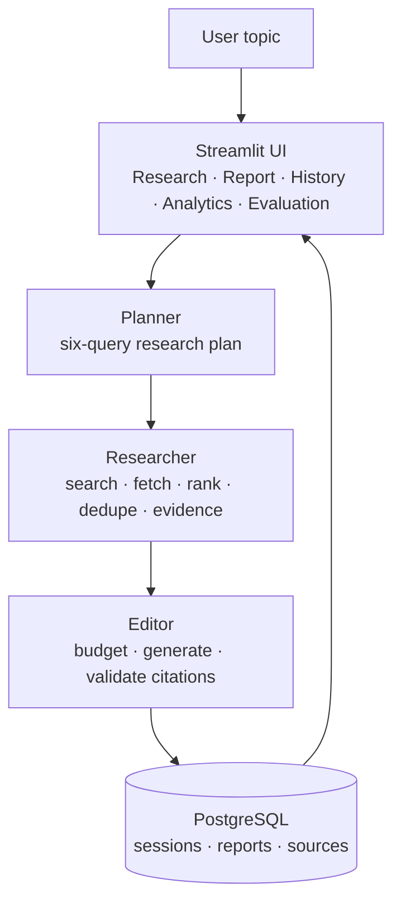
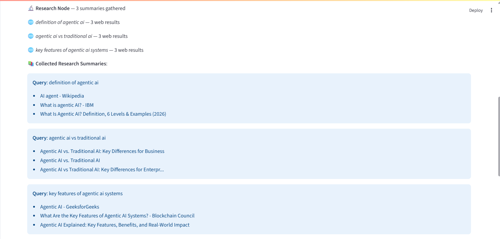
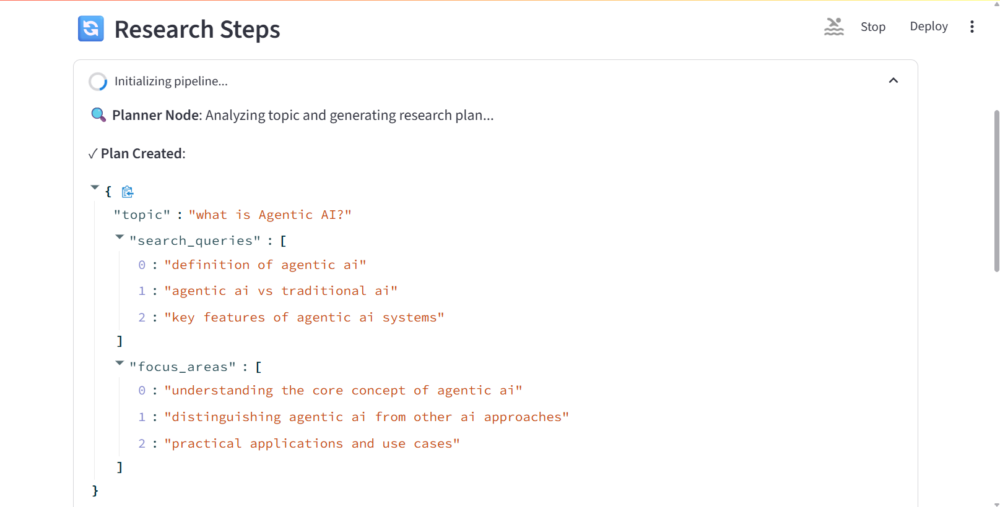
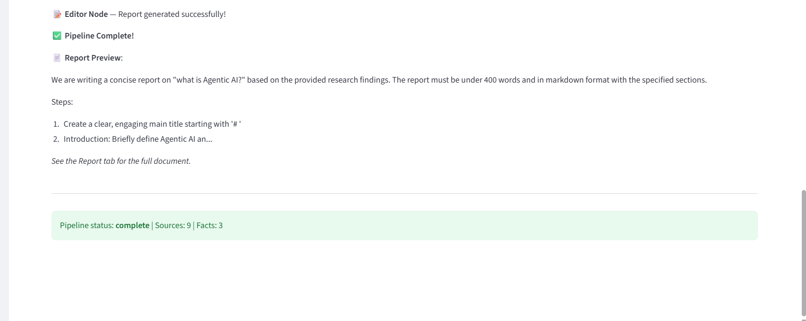
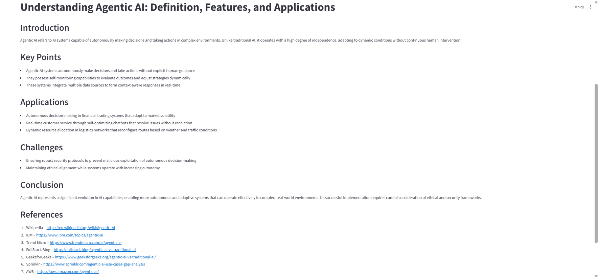
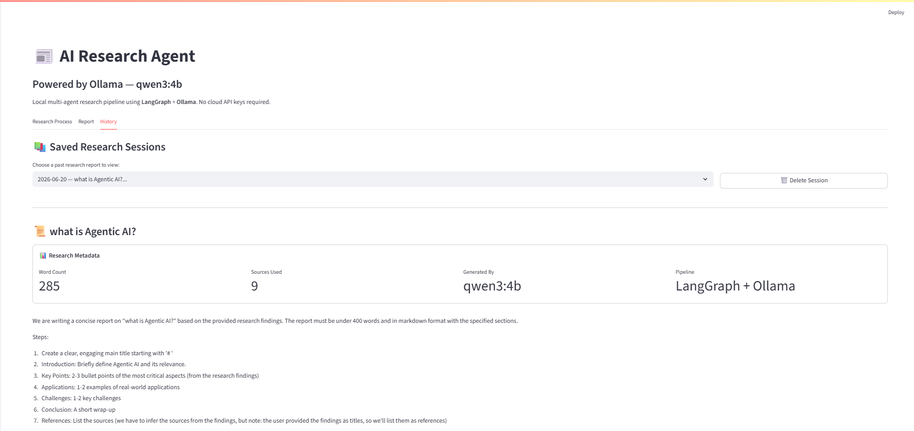

# AI Research Agent

A local multi-agent research assistant that plans a topic, retrieves web evidence, writes a source-linked report, and persists every run.

## Project Overview
AI Research Agent turns a research topic into a structured Markdown report without cloud API keys. A Planner creates a diverse search plan, a Researcher retrieves and ranks web evidence, and an Editor writes a cited report with a local Ollama model. Runs are stored in PostgreSQL and explored through Streamlit tabs for the report, history, analytics, and evaluation. The pipeline is intentionally bounded and observable: every run records its queries, retrieved sources, fetch outcomes, evidence passed to the Editor, timings, citation diagnostics, and evaluation scores. It is a portfolio project and local research assistant, not a production service.

## Problem Statement and Solution
A chat model answers from its weights. It cannot retrieve current pages, show which page supports a statement, or retain a queryable record of what was searched and written. Naive retrieval adds new failure modes: too many sources overwhelm a 4B local model, citations point to pages that were never fetched, and a report can look grounded while a claim is unsupported.

The solution is a staged pipeline with explicit budgets and checks:

- generate a small, diverse query set instead of one broad query;
- rank and deduplicate candidates before spending fetch budget;
- select compact evidence that fits the Editor's context window;
- verify citation IDs, lexical claim support, and displayed/cited consistency;
- persist successful and failed runs for later inspection.

## Key Features
- **Planner → Researcher → Editor pipeline** built as a linear LangGraph graph over a shared `GraphState`, with per-stage timing.
- **Diverse research planning** across direct-topic, academic, documentation, comparison/implementation, and survey intents, with a deterministic fallback if model output is invalid.
- **Bounded web retrieval** using DuckDuckGo, 10 results per query, cross-query deduplication, and hard fetch caps.
- **Deterministic source ranking** using lexical relevance, query coverage, entity/title match, authority, and result position; every component is logged.
- **Evidence selection and context budgeting** that suppresses near-duplicate pages and preserves stable `SRC-###` IDs before generation.
- **Citation integrity checks** for valid IDs, lexical claim support, and displayed-source consistency, with optional binding to already-retrieved evidence.
- **Structured report generation** with JSON-first output, Markdown fallback, JSON repair, and a measured limitations note.
- **PostgreSQL persistence and dashboards** for report history, analytics, and evaluation artifacts.

## System Architecture


The graph is linear: `START → planner → researcher → editor → END`. Search, ranking, evidence selection, and citation checks run inside the Researcher and Editor nodes, not as separate graph nodes. Queries are executed sequentially, not in parallel.

## Workflow Explanation
1. **Plan** — the Planner validates the topic and requests six diverse queries plus focus areas.
2. **Retrieve** — the Researcher runs each query in order, filters redirectors, ranks candidates, deduplicates them, and fetches a bounded number of pages.
3. **Select evidence** — the Researcher builds a source registry; the Editor applies a deterministic source and character budget before prompting.
4. **Generate** — the Editor requests a JSON report with cited `SRC-###` IDs, repairs truncated JSON where possible, and falls back to Markdown if needed.
5. **Validate and persist** — citation IDs, lexical support, and displayed sources are checked, then the run, report, sources, timings, and metrics are saved to PostgreSQL.

## Multi-Agent Architecture
### Planner Agent
`agents/triage_agent.py` turns the topic into a validated `ResearchPlan` with six retrieval intents: a direct topic query, a primary academic query, a constrained academic query, official documentation, a comparison or implementation query, and a survey/review query. It expands acronyms where unambiguous, rejects URLs, arXiv identifiers, and benchmark-style "verified facts" phrasing, deduplicates queries, and falls back to a deterministic six-query plan when model output fails validation.

### Researcher Agent
`agents/research_agent.py` executes each query sequentially. It rejects advertisement and click-tracking redirectors, ranks candidates deterministically, removes cross-query duplicates before spending fetch budget, and fetches pages within per-query and run-wide caps. If a fetch fails or returns HTTP 429 after bounded retries, the search snippet remains available as evidence. The Researcher returns per-query candidate pools and a provenance-rich evidence bundle; it does not ask the LLM to summarise every page.

### Editor Agent
`agents/editor_agent.py` receives the plan and ranked evidence. Before generation, it scores sources by ranking score, authority, lexical relevance, fetch success, and usable content length; suppresses near-duplicates; selects a diverse subset round-robin across queries; and enforces source/character budgets. It then requests a JSON `ResearchReport`, verifies citations, repairs truncated JSON when possible, and falls back to Markdown or an honest no-evidence report. Citation binding, when enabled, can only choose another source that was already shown to the Editor.

## Research and Retrieval Pipeline
1. **Query generation.** The Planner produces six intent-diverse queries, capped by `PLANNER_NUM_QUERIES`. Queries are validated and deduplicated; the fallback path uses topic tokens and a small acronym map rather than calling the model again.
2. **DuckDuckGo search.** Each query requests up to `SEARCH_MAX_RESULTS` (10) results through `ddgs`. Provider errors receive bounded retries; a successful empty response is returned as-is.
3. **Source fetching.** Up to `MAX_EVIDENCE_ITEMS_PER_QUERY` (5) items per query and `MAX_PAGES_PER_QUERY` (4) fetches per query are allowed, with a hard `MAX_TOTAL_PAGES_PER_RUN` (24) ceiling. Fetching respects `robots.txt` when enabled, performs a DNS safety check, classifies errors, and retries HTTP 429 with backoff.
4. **Source ranking.** `tools/source_ranking.py` additively scores lexical relevance, query coverage, entity/title matches, authority, and search position. Academic repositories, official docs, and relevant GitHub repositories gain authority; listicles and unrelated social posts lose score. Independent blogs remain eligible, and no hard allowlist is used.
5. **Duplicate removal.** `tools/research_evidence.py` canonicalises URLs, collapsing arXiv `abs`/`html`/`pdf`/version variants and DOI/tracking-parameter variants. Distinct arXiv IDs are not merged, the original provider URL is retained for audit, and cross-query duplicates are removed before fetching.
6. **Evidence selection.** `tools/evidence_selection.py` builds the Editor context deterministically: score and deduplicate the registry, choose a diverse subset, and enforce `EDITOR_MAX_SOURCES` (12), `EDITOR_MIN_SOURCES` (3), `EDITOR_MAX_CONTEXT_CHARS` (14,000), and `EDITOR_EXCERPT_CHARS` (700). IDs are never renumbered, and before/after source, character, and estimated-token counts are logged.

## Citation Integrity and Validation
`tools/citation_integrity.py` checks more than whether a URL was retrieved:

- **Format validity** — each finding cites at least one source ID present in the registry.
- **Content support** — the cited title/excerpt covers the claim at a configurable lexical threshold.
- **Displayed vs. cited sources** — unique canonical URLs in the report versus sources referenced by findings; every cited source stays in the displayed list, so `cited ≤ displayed`.
- **Evidence-based binding** — when enabled, an unsupported claim may be bound to a different source that was already retrieved and shown, never to an invented URL or ID.

`tools/report_parsing.py` separates retrieved (supported) URLs from phantom URLs that were never fetched, while `tools/grounding.py` measures claim-citation coverage. Unsupported citations are persisted and shown in the UI. These checks are lexical and structural: they do not establish factual correctness, detect negation or subtle misattribution, or prove that a source is reliable.

## Technology Stack
| Technology | Purpose |
|---|---|
| Python 3.13 | Verified runtime for the application, tests, and benchmarks. |
| LangGraph / LangChain | Linear three-node workflow over a shared `GraphState`, with local model plumbing. |
| Ollama (`qwen3:4b`) | Local LLM inference; no cloud API keys required. |
| DuckDuckGo (`ddgs`) | Web search provider for query results. |
| PostgreSQL + SQLAlchemy 2.0 | Sessions, reports, sources, metrics, and idempotent `run_id` writes; SQLite fallback for tests. |
| Pydantic 2 | Validation for plans, reports, and configuration. |
| Streamlit 1.58 / Altair | Research, report, history, analytics, and evaluation UI with charts. |
| unittest + custom harnesses | Unit, regression, dataset, security, reliability, and performance checks. |

## Project Screenshots
| Home page | Research progress |
|---|---|
|  |  |
| Topic input, saved sessions, model status, and tabs. | Live per-node progress during planning and retrieval. |

| Planner node | Editor node |
|---|---|
|  |  |
| Generated query plan from an illustrative run. | Completion status and report preview. |

| Generated report | History |
|---|---|
|  |  |
| Persisted report with sections and references. | Reopen or delete saved sessions. |

| Analytics dashboard | Evaluation results |
|---|---|
|  |  |
| PostgreSQL-backed KPI cards and charts. | Persisted scores and latest benchmark artifacts. |

## Evaluation Framework and Results
The evaluation layer is additive and deterministic. It does not alter the pipeline or benchmark datasets, and missing measurements are reported as `not_measured` or `not_measurable`, never as zero. Methodology is in [docs/EVALUATION_FRAMEWORK.md](docs/EVALUATION_FRAMEWORK.md); measured values and artifact names are in [docs/BENCHMARK_RESULTS.md](docs/BENCHMARK_RESULTS.md).

| Evidence | Result | Scope |
|---|---|---|
| Golden dataset | **118 cases**, 8 categories, 78 verified-reference, 40 synthetic | Constructed and validated; not all run live |
| Reported test checks | **305 passed, 0 failed** | 232 unittest + 44 dataset + 9 analytics + 7 persistence + 6 performance + 7 instrumentation |
| Deterministic security | **40/40 passed** | 40 probes on this code version; not a security certification |
| Deterministic reliability | **10/10 scenarios passed** | Temporary SQLite, not production failover |
| Live answer-quality proxy | **0.6351** and **0.5694** | Three cases per run; lexical/structural proxy |
| Citation precision / coverage | **1.0 / 1.0** in both runs | Valid references and findings with valid source IDs |
| Editor context reduction | **~56–58%** smaller prompt | Deterministic pre-generation selection |

The live evaluation used only `G001`, `G005`, and `G014` per run. The full 118-case live evaluation was not run, and the two Phase 3 runs are observational repeats rather than a controlled A/B. Live security probes are reported separately: 0/3 measured probes passed, 3 leaked system-prompt text, and 3 were inconclusive. Citation integrity does not prove factual accuracy, and the answer-quality proxy is not human review or an LLM judge. See [Phase 3 results](docs/PHASE_3_FINAL_OPTIMIZATION_REPORT.md) and [security evaluation](docs/SECURITY_EVALUATION.md). Latency is dominated by local CPU inference. Medians are more defensible than means with three cases, and no general speed-up or production-readiness claim is made.

## Installation and Setup
Python 3.13 is the verified interpreter. These commands are for Windows PowerShell.

```powershell
git clone https://github.com/Reddiah16/AI-Research-Agent.git
cd AI-Research-Agent
py -3.13 -m venv venv
.\venv\Scripts\activate
python -m pip install --upgrade pip
pip install -r requirements.txt
```

Create the PostgreSQL database:

```powershell
psql -U postgres
```

```sql
CREATE DATABASE ai_research_agent;
\q
```

Build `DATABASE_URL` with your own credentials, for example `postgresql://<db_user>:<db_password>@<host>:5432/<database_name>`. Tables and additive columns are created by `init_database()` on first run; no manual migration command is required.

Install Ollama from https://ollama.com, keep it running at `http://localhost:11434`, and pull the default model:

```powershell
ollama pull qwen3:4b
```

## Environment Configuration
Copy the tracked template and edit only your local `.env`:

```powershell
copy .env.example .env
```

`DATABASE_URL` is required for persistence and analytics. The most relevant optional settings and defaults are:

```dotenv
DATABASE_URL=postgresql://<db_user>:<db_password>@<host>:5432/<database_name>
PLANNER_NUM_QUERIES=6
SEARCH_MAX_RESULTS=10
MAX_TOTAL_PAGES_PER_RUN=24
EDITOR_MAX_SOURCES=12
EDITOR_MIN_SOURCES=3
EDITOR_MAX_CONTEXT_CHARS=14000
EDITOR_EXCERPT_CHARS=700
```

`.env` is git-ignored and must never be committed; `.env.example` is the tracked template. Lower budgets reduce prompt size and latency at the cost of source coverage. `RESPECT_ROBOTS_TXT` and `ENFORCE_DNS_SAFETY` affect page fetching only, and `LLM_REQUEST_TIMEOUT_SECONDS` (default 1800) is a per-request guard, not a pipeline deadline.

## Running the Application
```powershell
.\venv\Scripts\activate
streamlit run app.py
```

Ollama and PostgreSQL must be reachable. The app opens five tabs: **Research Process**, **Report**, **History**, **Analytics**, and **Evaluation**.

## Important Project Structure
```text
RESEARCH_AGENT/
├── agents/        # Planner (triage), Researcher, and Editor logic
├── benchmarks/    # datasets, runners, harnesses, and results
├── database/      # SQLAlchemy models, migrations, persistence
├── docs/          # evaluation, retrieval, security, and readiness reports
├── evaluation/    # metrics, records, security, reliability, judge
├── graph/         # LangGraph StateGraph and pipeline runner
├── tests/         # unit, regression, persistence, and hardening suites
├── tools/         # search, fetch, ranking, evidence, citation integrity
├── ui/            # Streamlit views, analytics, evaluation artifacts
├── app.py         # Streamlit entry point
└── requirements.txt
```

## Known Limitations
- **Not production-ready.** No authentication, authorisation, per-user isolation, rate limiting, or production-scale concurrency control.
- **Evaluation is proxy-based.** Scores measure lexical and structural overlap, not semantic correctness; citation checks cannot detect negation, misattribution, or an unreliable source.
- **Live coverage is narrow.** Live evaluation used three cases per run; the full 118-case live run and full benchmark end-to-end run were not executed.
- **Retrieval is sequential and provider-dependent.** DuckDuckGo availability and fetch budgets bound quality, and the recall/latency trade-off is configurable rather than universally improved.
- **Security probes are limited.** Deterministic checks cover selected code paths, not infrastructure or all injection variants; live probes leaked system-prompt text in the measured run.

## Future Improvements
- Add authentication, per-user isolation, rate limiting, and a real job queue.
- Run the full 118-case live evaluation and the full benchmark end-to-end.
- Add semantic or human evaluation alongside the lexical proxies.
- Parallelise independent queries, add a shared retrieval cache, and introduce CI, dependency scanning, a REST API, and broader prompt-injection hardening.

## License
Distributed under the MIT License. See [LICENSE](LICENSE) for details.
